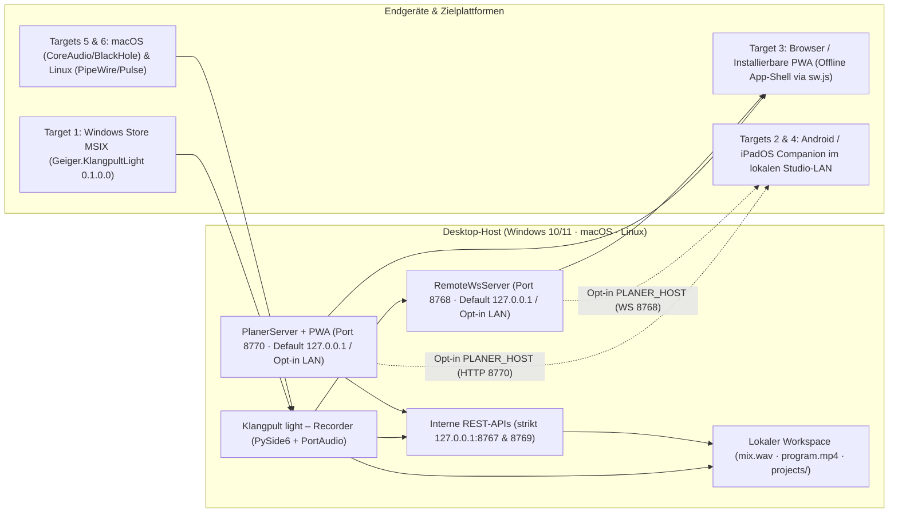

# PORTIERUNGSPLAN — Klangpult light (`DEV_KlangpultLight`)

- **Projekt:** `KlangpultLight` (`PRODUCTION/DEV_KlangpultLight`)
- **Repository:** `entertain-and-more/KlangpultLight` (Closed-Source / Private Freeware)
- **Version:** `0.1.0` (Core / Planer) · `0.1.0.0` (Windows Store MSIX, eingefroren gemäß `T-20260920-167562623`)
- **Stand:** `2026-11-15` (`TW-KLANGPULTLIGHT-15`)
- **Entscheidungsrahmen:** `PUBLICATION-POLICY.md` v1.2 §2 (Plattform-Strategie) & Policy P-006 (Tier-2 6-Sprachen-Standard: `de`, `en`, `es`, `zh`, `ja`, `ru`)

> Interne Strategie- und Architekturdatei (`PUBLICATION-POLICY.md` §2).
> Jede Plattformzeile zitiert explizit die tragenden Entscheidungsregeln (`Regel a`, `Regel b`, `Regel c`, `Regel e2`, `Regel g`, `Regel h`, `Regel i`).

---

## 1. Vorfrage (`PUBLICATION-POLICY.md` §2 Schritt 0)

**Braucht es überhaupt eine zweite Fassung neben der Windows-Desktop-Anwendung?**

| Prüffrage nach Schritt 0 | Antwort für `Klangpult light` |
|---|---|
| Gibt es eine Situation, in der der Nutzer die Zielplattform **zur Hand hat und den Windows-PC nicht**? | **Ja, differenziert nach Setting:** (1) Creator mit macOS- oder Linux-Arbeitsrechner nutzen denselben Desktop-Aufnahmeplatz ohne Windows-PC. (2) Während einer laufenden Aufnahme am Mikrofonarm hält der Sprecher ein lautloses Tablet/Smartphone für Teleprompter, Kapitelmarker und Soundboard-Pads in Reichweite, statt auf der mechanischen PC-Tastatur Störgeräusche zu erzeugen. |
| Bleibt die Kernfunktion ohne die Hardware/Umgebung des Desktops nutzbar? | **Auf macOS und Linux ja** (identische Python/PySide6/PortAudio-Laufzeit mit Mehrspur-USB-Interfaces). **Auf Mobilgeräten und im Browser nein für die Mehrspur-Aufnahme** (OS-Sandbox und WebAudio erlauben weder synchronen Multi-USB-Interface-Mix noch Desktop-Systemton-Loopback), **wohl aber ja für den eigenständigen Begleit-Usecase** (Episoden-/Line-Planung, Teleprompter, Pad-Fernsteuerung, Live-STT-Monitor). |
| Kommen die Daten auf der Zielplattform überhaupt an? | **Ja:** Auf Windows/macOS/Linux direkt im lokalen Datei-Workspace (`mix.wav`, `program.mp4`, `projects/`, `workspace-v1`); im Browser/Tablet-Companion lokal über den Same-Origin-Proxy `PlanerServer` (`8770`) und Echtzeit-WebSocket `RemoteWsServer` (`8768`, `remote_protocol_v1`). |

**Ergebnis der Vorfrage:**
- Eigenständige Desktop-Nutzung derselben Codebasis auf Windows, macOS und Linux ist gerechtfertigt (**Regel a**).
- Ein nativer Android- oder iOS-Vollport des Mehrspur-Recorders bringt keinen tragfähigen Mehrwert und verfehlt die Hardware-Voraussetzungen -> **explizites Nicht-Ziel nach Regel e2**.
- Die gekoppelte Web-App / installierbare PWA (`planer/`) besitzt dagegen einen **eigenen, vollwertigen Companion-Usecase** (lautloser Teleprompter & Touch-Soundboard-Pad-Auslöser am Mikrofonplatz sowie Vorbereitung im Browser) -> **gerechtfertigt nach Regel b, Regel c, Regel g und Regel h**.

---

## 2. Hosting-Absicht (`PUBLICATION-POLICY.md` §2 Schritt 3a)

**Soll die Anwendung irgendwann als zentral gehosteter Cloud-/SaaS-Dienst auf einem entfernten Server laufen?**

**Nein** (**Regel i** ausdrücklich verneint). `Klangpult light` verarbeitet persönliche Sprach-, Kamera- und Bildschirmaufnahmen strikt lokal (`INV-LOCAL-01` Zero Network Egress). Es gibt kein öffentliches Server-Backend, keine Benutzerkonten und keinen Cloud-Upload. Der `PlanerServer` (`8770`) läuft ausschließlich auf dem eigenen Rechner des Nutzers (Standard strikt `127.0.0.1`; optional per explizitem Opt-in `PLANER_HOST` / `PODCAST_RECORDER_COMPANION_HOST` im vertrauenswürdigen lokalen Studio-LAN).

---

## 3. Architektur-Grundsatz & Zwei-Werkzeug-Schnitt

`Klangpult light` trennt latenzkritische Mehrspur-Hardwareaufnahme und Vorbereitung/Live-Begleitung in zwei gekoppelte Werkzeuge innerhalb desselben Repositories:

1. **Klangpult light – Recorder (`Recorder/`)** — Lokale Desktop-Anwendung (Python 3.10+, PySide6 6.6+, `sounddevice`/PortAudio, `soundfile`, `opencv-python`, `mss`, `websockets`, optional FFmpeg & `faster-whisper`) für Mehrspur-Audio-/Videoaufnahme, Sound-/Videoboard mit Ducking, Systemton-Loopback und unveränderlichen Aufnahme-Branch-Baum.
2. **Klangpult light – Planer (`planer/`)** — Installierbare Local-First-Web-App / Progressive Web App (wartungsfreie Vanilla-ES-Module ohne Bundler-Zwang + lokaler Proxy `PlanerServer`) für Aufnahmen-Bibliothek, Projekt-/Episodenplanung, Asset-/Line-Reihenfolge (`klangpultlight-workspace-v1`), mehrsprachigen Teleprompter und Live-KI-Monitor (`remote_protocol_v1`).



---

## 4. Feature-Usecase-Plattform-Matrix

| Kernfunktion | Primärer Usecase | Windows Desktop / Store (T1) | Web-App / Local-First PWA `planer/` (T3) | macOS & Linux Desktop (T5/T6) | Android & iOS/iPadOS (T2/T4) |
|---|---|---|---|---|---|
| **Mehrkanal-USB-Audio & Echtzeit-Mixer** | 2+ USB-Mikrofone + Fader/Mute/Solo synchron mitschneiden | **Voll unterstützt** (PyInstaller Onedir / MSIX `runFullTrust`) | Nicht im Browser (WebAudio erlaubt kein stabiles Multi-Interface-Sync) | **Unterstützt (Source-Mode)** via PortAudio (`CoreAudio` / `PipeWire` / `ALSA`) | **Explizites Nicht-Ziel (Regel e2)** als native Recorder-App |
| **Systemton-Loopback („Was am PC läuft“)** | Systemsound parallel zum Mikrofon aufnehmen | **Nativ** via `WASAPI Loopback`, `Stereo Mix` oder `VB-CABLE` | Nicht zutreffend (Planungs- & Begleit-UI) | **Unterstützt** via `BlackHole` / `Soundflower` (macOS) bzw. `PipeWire` / `Monitor of …` (Linux) | **Explizites Nicht-Ziel (Regel e2)** |
| **Sound- & Videoboard mit Live-Ducking** | Jingles & Clips live in die Aufnahme einspielen | **Voll unterstützt** (lokale Engine + Hotkeys `1`–`8`) | **Planung (`Assets & Line`) + Live-Fernsteuerung** via `remote_protocol_v1` (**Regel c**, **Regel g**) | **Unterstützt (Source-Mode)** | **Als Companion-Remote unterstützt** (Pad-Trigger & Mute via PWA, **Regel c**, **Regel g**) |
| **Video-Capture & Split-Compositor** | Webcam + Bildschirmaufnahme als `program.mp4` | **Voll unterstützt** (`cv2` + `mss` + `ffmpeg`) | Nicht im Browser | **Unterstützt (Source-Mode)** sofern `ffmpeg` im `PATH` installiert ist | **Explizites Nicht-Ziel (Regel e2)** |
| **Bibliothek, Episoden- & Rundown-Planung** | Vorbereitung am Schreibtisch, Zweitbildschirm oder Studio-Tablet | Über Ein-Klick-Button (`Strg+P`) direkt gekoppelt | **Primärziel** (installierbare PWA mit Offline-App-Shell `sw.js`, **Regel b**, **Regel h**) | Direkt im Standardbrowser (`http://127.0.0.1:8770`) | **Unterstützt via PWA / Browser** im lokalen Studio-LAN (**Regel b**) |
| **Teleprompter & KI-Monitor** | Geräuschloses Mitlesen & Live-Stichworte während der Session | Im gekoppelten Browserfenster | **Primärziel** (Tastatur, Touch, Spiegelmodus, Live-STT-Scroll) | Im gekoppelten Browserfenster | **Idealer Companion-Usecase:** Tablet am Mikrofonarm via `ws://<LAN-IP>:8768` (**Regel c**, **Regel g**) |

---

## 5. Plattformentscheidungen nach `PUBLICATION-POLICY.md` §2 Schritt 4

| Target / Plattform | Entscheidung | Begründung & Pflicht-Regelzitat (`PUBLICATION-POLICY.md` §2) | Status (`2026-11-15`) |
|---|---|---|---|
| **1) Windows Store Release (`0.1.0.0` MSIX)** | **Ziel (Primärkanal Desktop)** | **Regel a** — Eigenständige Hauptanwendung für Windows 10/11 (`x64`) mit vollem Mehrspur-USB-, WASAPI-Loopback- und Video-Funktionsumfang; signiertes MSIX-Paket (`Geiger.KlangpultLight`) beseitigt SmartScreen-Hürden für Freeware-Nutzer. | **Staging & WACK-Preflight bereit** (`store_package/`, `releases/windowsstore/`, `check_store_readiness.py`, `run_windows_wack.py`). |
| **3) Web-App / Local-First PWA (`planer/`)** | **Ziel als gekoppelte Zweitoberfläche & Companion** | **Regel b**, **Regel c**, **Regel g** und **Regel h** — Zweite Oberfläche im selben Repository auf geteilten Schemas (`workspace-v1`, `remote_protocol_v1`) und identischem 6-Sprachen-Wörterbuch (`locales/translations.json`) mit lokalem Echtzeit-Sync über `BridgeService`; kein Cloud-Hosting (**Regel i** verneint). | **Produktiv & installierbar** (`manifest.json`, `sw.js`, `pwa.js`, Allowlist-Icons aus `mobile_icons/`, `6/6` Node-ESM-Tests grün). |
| **5) macOS-Version (`darwin`)** | **Ziel im Source-Mode (kein App-Store-`.dmg`)** | **Regel a** für identische Python/PySide6/PortAudio-Nutzung aus dem Quellcode (`CoreAudio`, `BlackHole`/`Soundflower`-Erkennung, `open`); **Regel e2** gegen eigenen App-Store-/Notarisierungs-Build mangels separater Binärpaket-Nachfrage. | **Source-Mode & CI verifiziert** (`macos-latest`, `get_platform_loopback_hint('darwin')`, `source_platform_smoke.py` `7/7` grün). |
| **6) Linux-Version (`linux`)** | **Ziel im Source-Mode (kein Flatpak/Snap)** | **Regel a** für direkte Python/PySide6/PortAudio-Nutzung am Linux-Desktop (`PipeWire`/`PulseAudio Monitor`-Erkennung, `xdg-open`); **Regel e2** gegen separate Distributionspakete bis konkreter Bedarf belegt ist. | **Source-Mode & CI verifiziert** (`ubuntu-latest`, `get_platform_loopback_hint('linux')`, `source_platform_smoke.py` `7/7` grün). |
| **2) Android-Version** | **Nicht-Ziel als nativer Recorder-Port (Abdeckung via Companion-PWA)** | **Regel e2** gegen nativen Android-Recorder-Clone (kein synchroner Multi-USB-Mix / PC-Systemton-Loopback); **Regel b**, **Regel c** und **Regel g** für den eigenständigen mobilen Begleit-Usecase (Touch-Soundboard-Pads & Teleprompter im lokalen Studio-LAN). | **Companion-Modus bereit** (`PLANER_HOST`-Opt-in bindet HTTP `8770` + WS `8768` synchron; interne APIs `8767`/`8769` bleiben auf `127.0.0.1`). |
| **4) iOS- / iPadOS-Version** | **Nicht-Ziel als nativer Recorder-Port (Abdeckung via Companion-PWA)** | **Regel e2** gegen native iOS-Recorder-App (Sandbox-Restriktionen & doppelter Pflegeaufwand ohne Desktop-Audio-Bus); **Regel b**, **Regel c** und **Regel g** für den iPad-/iPhone-Teleprompter & Pad-Auslöser über die installierbare PWA (`apple-touch-icon`). | **Companion-Modus bereit** (`resolveDefaultWsUrl()` in `planer/app/remote.js` + Home-Screen-Web-App). |

---

## 6. Sicherheits-, Barrierefreiheits-, Qualitäts- & Release-Garantien

### d) Datenschutz, Zero-Telemetry, Sandbox, Berechtigungen & Signierung
- **Zero-Egress (`INV-LOCAL-01`):** Im Standardbetrieb binden alle vier lokalen Dienste (`LibraryApiServer` `8767`, `RemoteWsServer` `8768`, `ProjectsApiServer` `8769`, `PlanerServer` `8770`) ausnahmslos auf `127.0.0.1`. Setzt der Nutzer für den Studio-Tablet-Betrieb explizit `PLANER_HOST` (oder `PODCAST_RECORDER_COMPANION_HOST`), öffnen `BridgeService` und `Recorder/main.py` gezielt nur `PlanerServer` (`8770`) und `RemoteWsServer` (`8768`) im lokalen Studio-Netz, während `LibraryApiServer` (`8767`) und `ProjectsApiServer` (`8769`) strikt auf `127.0.0.1` hinter dem Same-Origin-Proxy isoliert bleiben. Keine externen CDNs, Webfonts, Tracking-Pixel oder Telemetrie (`PRIVACY_POLICY.md`, `SECURITY.md`).
- **Least-Privilege & MSIX-Sandbox:** Ausführung strikt als `RunAsInvoker` ohne UAC-Administratorrechte. `AppxManifest.xml` deklariert ausschließlich `runFullTrust` (PySide6/PortAudio-Desktop-Bridge), `microphone` und `internetClient` (lokales Loopback-/Studio-LAN-Networking). Paketsignierung erfolgt mit SHA-256 (`SignTool.exe sign /fd SHA256`).
- **Closed-Source Freeware-Schutz:** `Klangpult light` wird als kostenlose Freeware vertrieben (`LICENSE`: Proprietary / Freeware), das Quellcode-Repository bleibt strikt `private`.

### e2 & Policy P-006) Barrierefreiheit (`EN 301 549` / `WCAG 2.1 AA` / `BITV 2.0`) & Tier-2-Mehrsprachigkeit
- **Barrierefreiheit (`EN 301 549` / `WCAG 2.1 AA` / `BITV 2.0`):** Vollständige Tastaturbedienbarkeit im Desktop-Recorder (`F1` Tastaturkürzel-Dialog, `Ctrl+R` Aufnahme, `Ctrl+T` Titel, `Ctrl+P` Planer öffnen, `Ctrl+1..5` Panels ein-/ausklappen, `F5` Aktualisieren, `Ctrl+Q` Beenden, `accessibleName`/`accessibleDescription` auf allen Bedienelementen) sowie semantische Landmarken, Skip-Link, `aria-live`-Statusmeldungen, sichtbare `:focus-visible`-Konturen und kontrastgeprüftes Dark-Studio-Theme (`#2b3142`) in der Planer-PWA (`Recorder/tests/test_planer_a11y.py`, `Recorder/tests/test_ui_accessibility.py`).
- **Tier-2 6-Sprachen-Parität (`Policy P-006`):** `100,0 %` Abdeckung über alle `80` Übersetzungsschlüssel in `de`, `en`, `es`, `zh`, `ja` und `ru` mit deterministischer 4-Stufen-Fallback-Kette (`target -> en -> de -> key`), sowohl im Quellbetrieb als auch in PyInstaller-Onefile/Onedir- und MSIX-Builds (`("locales", "locales")` in beiden `.spec`-Dateien) sowie in allen 6 Store-Listings nach Richtlinie `10.1.3`.

### f) Testmatrix, Zustandsisolierter Cross-Platform-Smoke & Rollback-Strategie
- **Automatisierte Qualitäts-Gates:** Jede Änderung durchläuft `scripts/check_store_readiness.py` (`60+` Store-/Manifest-/Listing-Prüfungen), `scripts/run_windows_wack.py` (statischer WACK-Preflight + optionaler `shell=False` `appcert.exe`-Aufruf), `tests/source_platform_smoke.py` (`7/7` Plattform- & PWA-Smokes in isoliertem `TemporaryDirectory` + `QSettings.Format.IniFormat` ohne Berührung echter Benutzerprofile), `manage_translations.py --check`, `node --test planer/tests/pwa.test.mjs` und die vollständige Pytest-Suite (`615+` Tests).
- **Rollback-Strategie:** Vor jedem Git-Commit/Push wird ein lokaler Rettungs-Branch (`rescue/YYYYMMDD-HHMM`) angelegt. MSIX-Artefakte sind versionsgepinnt (`0.1.0.0`); der Planer-Service-Worker (`planer/sw.js`) versioniert seinen App-Shell-Cache (`klangpult-light-planer-shell-v1`) und räumt veraltete Caches im `activate`-Lebenszyklus deterministisch ab.

### h) Vier-Augen-Prinzip (Unabhängige Tier-1-Zweitabnahme)
- Jede substanzielle Architektur-, Portierungs-, Übersetzungs-, Sicherheits- oder Store-Änderung durchläuft vor Commit und Spiegelung zwingend eine unabhängige **4-Augen-Abnahme** durch einen separaten Read-Only-Reviewer-Subagenten auf Tier-1-Modellgüte (`thinker_reviewer`) am eingefrorenen Arbeitsbaum (`IMPRIMATUR: PASS`, `0 P0 / 0 P1 / 0 P2`).

### i) Externe Veröffentlichungs-Sperre (Release-Freeze)
- Automatisierte Agentenläufe bereiten Builds, Manifeste, WACK-Prüfungen und Staging-Dokumente lokal vor, führen jedoch **niemals** eigenmächtig Uploads ins Microsoft Partner Center, öffentliche Releases oder Sichtbarkeitsänderungen durch. Externe Freigaben laufen ausschließlich über `TO-DECIDE-USER.txt` durch den Rechteinhaber.

---

## 7. Explizite Nicht-Ziele (Abgrenzung gegen Scope-Creep)

1. **Kein nativer Android-/iOS-Audio-Recorder-Klon (`Regel e2`):** Ein nativer mobiler Nachbau der Mehrspur-Engine würde die zentrale Produktzusage (parallele USB-Mikrofone + Desktop-Systemton-Mitschnitt) technisch verfehlen und eine zweite Codebasis erzwingen.
2. **Kein gehostetes Cloud-SaaS-Backend für den Planer (`Regel i` verneint):** Alle Projektdaten, Episodennotizen und Aufnahmen verbleiben lokal im Benutzer-Workspace (`INV-LOCAL-01`).
3. **Keine Postproduction-Features in `Klangpult light`:** Kein Schnitt-Editor (EDL/Cutter), kein Batch-Transkriptdatei-Export (SRT/VTT) und kein direkter Plattform-Upload — diese Funktionen bleiben der Vollversion `Klangpult` vorbehalten (`KONZEPT.md`).
4. **Keine externe Store-Einreichung ohne Nutzerentscheid:** Partner-Center-Uploads bleiben strikt über `TO-DECIDE-USER.txt` gesperrt.

---

## 8. Verifikations-Kommandos (Multi-Target Quality Gates)

```bash
# 1. Windows Store Readiness & Richtlinie 10.1.3
python scripts/check_store_readiness.py

# 2. Hermetischer Windows WACK Preflight-Check (statisch + optional SDK appcert.exe)
python scripts/run_windows_wack.py

# 3. Cross-Platform Source-Smoke (Windows / macOS / Linux Profile, isoliertes QSettings & Temp-Workspace)
python tests/source_platform_smoke.py

# 4. Tier-2 6-Sprachen-Audit (DE, EN, ES, ZH, JA, RU)
python manage_translations.py --check

# 5. Web-App / PWA & Companion ESM-Modultests (Node.js)
node --test planer/tests/pwa.test.mjs

# 6. Vollständige Python-Vertrags- und Komponententests
python -m pytest -p no:flask tests Recorder/tests
```
